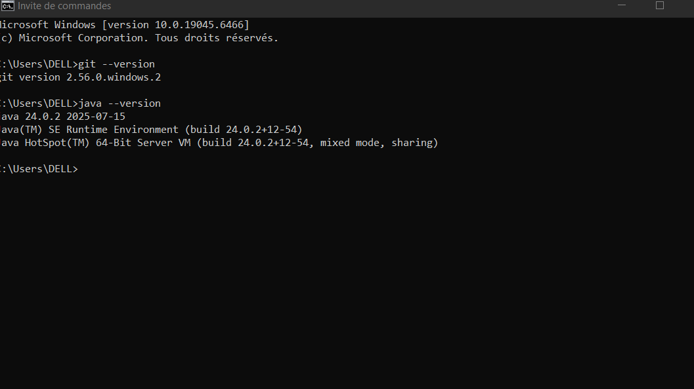
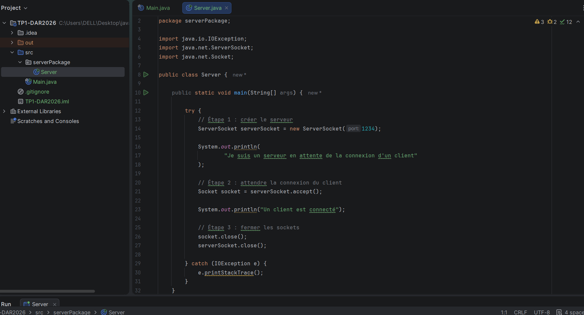
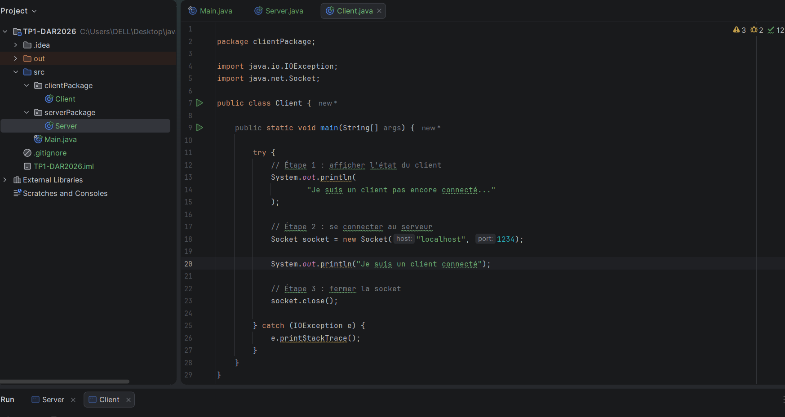

# TP1-DAR2026 — Première connexion Client/Serveur

## 1. Objectif
L'objectif de ce TP est d'établir une communication entre un client et un serveur en Java à l'aide des sockets TCP.

## 2. Vérification de l'environnement
- Git : vérification avec la commande `git --version`.
- Java : vérification avec la commande `java --version`.

  

## 3. Création du serveur
J'ai créé le package `serverPackage` et la classe `Server`.
Le serveur utilise `ServerSocket` sur le port 1234 et attend la connexion d'un client grâce à la méthode `accept()`.

## 4. Création du client
J'ai créé le package `clientPackage` et la classe `Client`.
Le client utilise `Socket` pour se connecter au serveur sur `localhost`, port 1234.

## 5. Interprétation des résultats
Le serveur attend la connexion du client. Lorsque le client se connecte, le serveur affiche le message « Un client est connecté ». Le client affiche également un message confirmant sa connexion.

## 6. Test avec une adresse IP
J'ai remplacé `localhost` par `127.0.0.1` et vérifié que la connexion fonctionne toujours sur le même ordinateur.

